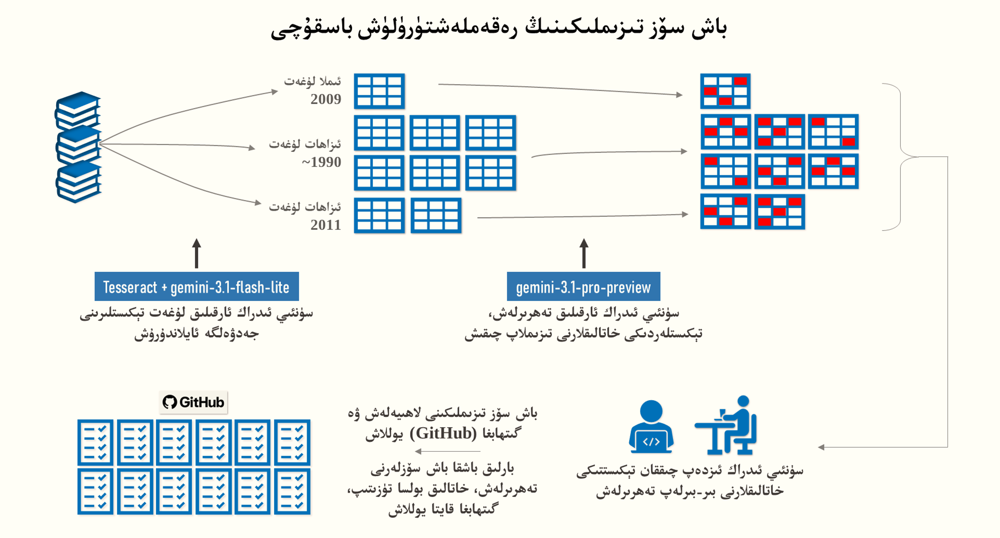

# Uyghur Headword Lists

Open, machine-readable headword lists extracted from three printed Uyghur
dictionaries, released as plain TSV under CC BY 4.0.

<!-- stats:headline -->
**131,707 written forms** and **48,241 sub-entry phrases**, each traceable to
the scanned column it came from.
<!-- stats:end -->

[](https://doi.org/10.5281/zenodo.22747775)
[](https://archive.softwareheritage.org/browse/origin/?origin_url=https://github.com/UyghurReferenceTexts/uyghur-headword-lists)
[](https://orcid.org/0009-0004-4633-0408)
[](https://creativecommons.org/licenses/by/4.0/)

<p align="center">
  
</p>

*How the lists are digitized.* The three dictionaries (2009 imla; 1990s, six
volumes; 2011, two volumes) were converted to spreadsheets with Tesseract and
`gemini-3.1-flash-lite`. `gemini-3.1-pro-preview` then compared each spreadsheet
against the scanned pages and flagged likely errors. A native speaker checked
every flag against the scan, one by one, and the headword lists were built and
published here. The remaining headwords are being checked the same way, with
corrections pushed to this repository as they are made.

---

## Why this exists

The Uyghur language is targeted for systematic eradication within its homeland of East Turkistan (شەرقىي تۈركىستان), which remains under brutal Chinese occupation. Since 2017, Beijing has weaponized the education system across occupied East Turkistan (imposed upon by the Chinese colonial name "Xinjiang," literally meaning "new territory") to obliterate Uyghur-language instruction and violently enforce Mandarin. Uyghurs and other Turkic peoples are routinely herded into concentration camps masquerading as "re-education" centers, where they endure psychological abuse and are forbidden from speaking their mother tongue. While the UN has formally concluded these atrocities may constitute crimes against humanity, multiple international parliaments have rightfully called this campaign exactly what it is: an ongoing genocide. What researchers clinically call "Sinicization" is, in reality, a ruthless colonial project designed to strip an entire nation of its voice, culture, and existence.

Amidst this systematic erasure, the practical urgency of this project is clear. The foundational reference works defining standard written Uyghur are now endangered physical artifacts—held in rapidly shrinking numbers and written in a script that modern digital infrastructure largely fails to support. A dictionary that exists only on paper can be easily confiscated, censored, or destroyed. A dictionary transformed into an open, versioned, and globally mirrored dataset with a permanent DOI is indestructible.

This repository provides the concrete technical foundation for that preservation: it extracts the headword inventories of three major Uyghur dictionaries and transforms them into a robust, machine-readable format. It ensures this linguistic data becomes something a machine can process, a researcher can securely cite, and a spellchecker can use to keep the language alive on modern devices.

## Why the lists are filtered

The 2011 and 1990s source dictionaries were compiled under the very same state apparatus whose assimilationist policies this project counters. One visible legacy of that state control is a layer of Chinese transliterations artificially inserted as Uyghur headwords, tagged as `[خەن]` in the original etymology columns. Standardizing a state-mandated loanword in a reference dictionary is a deliberate tactic to make it appear settled, ordinary, and official. Uyghur linguists have a specific term for the endpoint of this process: *تولۇق ئاسسىمىلياتسىيە* (total assimilation).

To counteract this, 1,120 entries were reviewed individually across two rounds. We removed 982 from the final lists because they are forced transliterations that never took root in natural Uyghur usage — 1,099 TSV rows once their variant and sub-entry forms are counted. The remaining 138 were preserved—either because the original tag was an OCR error on a native Uyghur word, or because the loanword has been genuinely integrated into the living language.

This is a deliberate editorial intervention, and we prioritize absolute transparency over silent deletion. Every removed entry is documented in [`excluded/excluded_wordlist.tsv`](excluded/excluded_wordlist.tsv) alongside its original `row_id`, source dictionary, and scanned page, allowing anyone who disagrees with this assessment to trace or reverse the decision. Crucially, this curation was performed word-by-word by a native Uyghur speaker rather than by automated pattern matching. This human review ensures precision; for example, several rejected Chinese transliterations share spellings with legitimate Uyghur homographs (such as جازا *punishment*, پەن *science*, and باشى *his head*), which remain fully intact and protected within the dataset.

**This list will grow, and entries may be restored.** The 2009 imla dictionary has no etymology column at all, so its transliterations cannot be identified systematically — they are found by cross-reference against the 2011 dictionary, or one at a time during the ongoing audit. Expect further removals as that work proceeds. Equally, a removal is a judgment and not a verdict: where the community makes a case that a form did enter ordinary Uyghur usage, it can be restored. Open an issue.

---

## What's in the data

Each dictionary directory holds a `_headwords.tsv` and, where the source has
them, a `_subentries.tsv`.

**Orthography differs by source.** The 2009 imla dictionary and the 2011
explanatory dictionary follow the 2009 orthographic standard. The six 1990s
volumes predate it and are published in their original spelling, not
normalized, so the same word can appear in two spellings across works. Filter
by directory if you need one standard only.

### `*_headwords.tsv`

| column        | meaning                                                      |
| ------------- | ------------------------------------------------------------ |
| `row_id`      | stable identifier; suffixes `-i1` `-v1` `-c1` mark forms derived from a parent row |
| `entry`       | the written form                                             |
| `type`        | `headword`, `verb_stem`, `variant`, `inflected`, `nonstandard`, `corrected_form` |
| `source_page` | the scanned column image this came from                      |
| `status_v1`   | `verified`, `unverified`, or blank — see *Audit rounds*      |

### `*_subentries.tsv`

| column        | meaning                             |
| ------------- | ----------------------------------- |
| `sub_id`      | stable identifier                   |
| `parent_id`   | the `row_id` this phrase belongs to |
| `phrase`      | the compound or multi-word entry    |
| `source_page` | scanned column image                |
| `status_v1`   | as above                            |

### Entry types

- `headword` — a lemma as printed.
- `verb_stem` — printed with a stem marker; the citation form adds `-ماق`/`-مەك`.
- `inflected` — a possessive or other inflected form the dictionary prints in
  parentheses after the lemma (`ئاكسىيە (ئاكسىيەسى)` yields both).
- `variant` — an equivalent or cross-reference target (`X = Y`, `X ← Y`).
- `nonstandard` — a spelling the dictionary records in order to correct it.
- `corrected_form` — the standard spelling a `nonstandard` entry points to.

One line per distinct written form. Homonyms printed as `ئاپپاق I` and
`ئاپپاق II` collapse to a single line, since the list is an inventory of
orthography, not of senses.

---

## Coverage

<!-- stats:coverage -->

| work                                                        | headwords   | sub-entries | verified   | excluded  |
| ----------------------------------------------------------- | ----------- | ----------- | ---------- | --------- |
| [Imla Lughiti 2009](data/imla_lughiti_2009/)                | 37,913      | 43,412      | 6,415      | 306       |
| [Izahliq Lughet 1990s](data/izahliq_lughet_1990s/) (6 vols) | 53,799      | 4,829       | 10,629     | 443       |
| [Izahliq Lughet 2011](data/izahliq_lughet_2011/) (2 vols)   | 39,995      | 0           | 8,167      | 350       |
| **total**                                                   | **131,707** | **48,241**  | **25,211** | **1,099** |
<!-- stats:end -->

Counts are **after** the exclusions described above; the *excluded* column shows
how many rows were removed from each work.

Load a whole multi-volume work with a glob:

```python
import pandas as pd, glob
df = pd.concat(pd.read_csv(f, sep="\t", dtype=str)
               for f in glob.glob("data/izahliq_lughet_1990s/*_headwords.tsv"))
```

---

## This dataset is being corrected continuously

**These files change. That is the point, not a defect.**

The lists were produced by OCR of printed scans and then audited by a native
speaker, page by page, against the original images. The audit is ongoing and
will take months. Expect a steady stream of corrections, and expect the raw
counts above to drift as errors are fixed, duplicates merge, and skipped
entries are restored.

Pin a release tag or a DOI if you need reproducibility. Track `main` if you want
the most correct data.

### Audit rounds

`status_v1` records the first full audit pass:

- `verified` — a human compared this entry against the scan and confirmed it.
- `unverified` — not yet reached. The entry is OCR output that has passed
  automated checks only.
- *blank* — the entry was added after round 1 had already passed that page.

<!-- stats:verified -->
Currently **25,211 of 131,707 forms (19.1%) are verified**.
<!-- stats:end -->

 When round 2 begins, a
`status_v2` column is appended rather than overwriting round 1, so the history
of what was checked when stays in the file. **The current status of an entry is
its last non-empty `status_vN` column.**

### Known limitations

**Missing pages.** Some source volumes were scanned from copies with pages
absent. Headwords on these pages are simply not present:

| volume                     | missing pages                           |
| -------------------------- | --------------------------------------- |
| 1990s v1                   | 215, 216, 452, 453, 689                 |
| 1990s v2                   | 414, 415, 450, 451, 804, 805            |
| 1990s v3                   | 96, 97                                  |
| 1990s v4                   | 6, 7, 44, 45, 80, 81, 714–717, 940, 941 |
| 1990s v5                   | 20, 21                                  |
| 1990s v6, 2011 v1, 2011 v2 | none                                    |

**Printing errors in the sources.** The printed dictionaries contain their own
typesetting mistakes, faithfully reproduced here unless flagged. From the 2009
imla dictionary:

- `مەخپىيلەشتۈرۈلۈش | مەخپىيلەشتۈرۈلۈش` — the first should read
  `مەخپىيلەشتۈرۈلمەك`
- `ئوبراز (ئوبزارى)` — should read `ئوبراز (ئوبرازى)`

These are errors of the source, not of the extraction. Where the intended form
is unambiguous it is corrected and noted in the changelog; where it is not, the
printed form stands.

**Remaining OCR errors, and missing or spurious entries.** 80.9% of entries have
not yet been checked by a human. Assume a residual error rate in that portion.
The audit finds three distinct problems, not one: characters misread by OCR,
headwords the OCR skipped entirely, and — where a machine-assisted pass was
used — plausible-looking entries that are not in the printed dictionary at all.
All three are corrected as they are found, which is why the totals above are a
snapshot rather than a fixed figure.

---

## What machines got wrong: an OCR audit benchmark

All three dictionaries were audited with assistance from `gemini-3.1-pro-preview`,
which read each scanned column alongside the rows OCR had produced from it. Every
proposed correction was then checked by a native speaker against the scan. The
result is worth publishing on its own, because it quantifies something the field
mostly guesses at: **how far a frontier model can be trusted on a low-resource
script.**

| dictionary                    | proposals verified | accepted  | precision |
| ----------------------------- | ------------------ | --------- | --------- |
| Imla Lughiti 2009             | 4,045              | 3,072     | 75.9%     |
| Izahliq Lughet 2011 (2 vols)  | 4,195              | 2,815     | 67.1%     |
| Izahliq Lughet 1990s (6 vols) | 7,694              | 3,673     | 47.7%     |
| **total**                     | **15,934**         | **9,560** | **60.0%** |

**Two proposals in five were wrong, and the model never said so.**
Self-reported confidence carried no information: 99.9% of the 2009 findings,
4,194 of 4,195 in 2011 and 7,688 of 7,694 in the 1990s were labelled "high",
including every one that was wrong. There is no threshold that separates right
from wrong.

### Imla Lughiti 2009

| issue type                                       | verified | accept rate |
| ------------------------------------------------ | -------- | ----------- |
| `split_parenthetical` — text in the wrong column | 482      | 100%        |
| `truncated_equals` — cross-reference cut off     | 71       | 100%        |
| `other`                                          | 32       | 97%         |
| `merged_entries`                                 | 20       | 95%         |
| `wrong_characters` — spelling                    | 3,042    | 80%         |
| `missing_headword` — entry allegedly skipped     | 395      | 7%          |
| `wrong_order`                                    | 1        | 0%          |

**Reliable on layout, unreliable on language.** Where the task was positional —
*this text sits in the wrong column* — the model was essentially perfect across
553 findings. Where it required knowing what a Uyghur word should look like,
accuracy fell to 80%. Where it required understanding how a Uyghur dictionary is
organized, it collapsed to 7%: the model repeatedly reported compounds as
"missing headwords" when they were already present as sub-entries of the
preceding lemma, which is simply how this dictionary lists compounds.

### Izahliq Lughet 2011

The two volumes were audited independently.

| issue type                                     | vol 1     | vol 2     | combined          |
| ---------------------------------------------- | --------- | --------- | ----------------- |
| `truncated_arrow_equals` — cross-reference cut | 139/139   | 112/112   | 251/251 (100%)    |
| `missing_headword` — entry skipped by OCR      | 487/544   | 454/479   | 941/1,023 (92%)   |
| `wrong_characters` — spelling                  | 760/1,324 | 846/1,308 | 1,606/2,632 (61%) |
| `inflection_error`                             | 8/127     | 5/60      | 13/187 (7%)       |
| `extra_row` — entry allegedly spurious         | 2/47      | 0/38      | 2/85 (2%)         |
| `wrong_order`                                  | 0/11      | 0/3       | 0/14 (0%)         |
| `other`, `merged_entries`                      | 1/2       | 1/1       | 2/3               |

The volume 2 figure is higher overall mainly because its mix is heavier in
`missing_headword`, a class the model does well; class by class, the volumes
agree.

### Izahliq Lughet 1990s

Six volumes, audited one after another with the same workflow. Each volume's
spreadsheet holds a full benchmark sheet; the summary is:

| volume    | proposals | accepted  | precision | `wrong_characters` precision |
| --------- | --------- | --------- | --------- | ---------------------------- |
| vol 1     | 1,111     | 574       | 51.7%     | 34.8%                        |
| vol 2     | 1,274     | 621       | 48.7%     | 32.2%                        |
| vol 3     | 1,533     | 642       | 41.9%     | 26.3%                        |
| vol 4     | 1,395     | 724       | 51.9%     | 37.5%                        |
| vol 5     | 1,244     | 552       | 44.4%     | 27.5%                        |
| vol 6     | 1,137     | 560       | 49.3%     | 34.9%                        |
| **total** | **7,694** | **3,673** | **47.7%** | **32.0%**                    |

| issue type                                     | verified | accept rate |
| ---------------------------------------------- | -------- | ----------- |
| `missing_headword` — entry skipped by OCR      | 1,467    | 98%         |
| `extra_row` — entry allegedly spurious         | 153      | 90%         |
| `truncated_arrow_equals` — cross-reference cut | 282      | 86%         |
| `wrong_order`                                  | 15       | 80%         |
| `wrong_characters` — spelling                  | 5,770    | 32%         |
| `other`, `inflection_error`                    | 7        | 1/7         |

Structure was handled well; spelling was the worst of the three books. Four
edit patterns account for most of the damage:

| proposal whose only change is…  | proposals | correct |
| ------------------------------- | --------- | ------- |
| deleting one ى                  | 1,256     | 7%      |
| ۇ → و                           | 447       | 4%      |
| ۇ or ۈ → ۆ                      | 502       | 2%      |
| ې → ى                           | 282       | 5%      |
| **all four**                    | **2,487** | **5%**  |

These four patterns are 43% of all `wrong_characters` proposals but hold only
123 of the 1,846 real fixes (7%). Set them aside and the rest of the category is
right 52% of the time. The pattern was stable across all six volumes: ى
deletion scored between 4% and 10% in every one.

**The model reads with a language prior, not the pixels.** In volumes 1–5
each spelling proposal was checked against the volume's own definitions. When
the scanned form occurs in the definitions and the model's form does not, the
model was right 8% of the time (164 of 1,996). When it was the other way round —
the scanned form unattested, the model's form attested — it was right 84%
(287 of 343). Whether the proposed word exists elsewhere in the same book is a
better guide to a proposal than anything the model says about it.

The 1990s volumes predate the 2009 spelling standard, and some of these
patterns (a second-syllable ى kept, ۇ in Russian loanwords) may be the model
"modernizing" older spellings; the volume sheets tag 48–76% of character
rejections as spelling-standard-sensitive. That cannot be the whole story,
though, because the ۇ → و bias is just as strong in the 2011 dictionary, which
follows the 2009 standard.

### Vowels: the same failure in two books

Proposals whose only change was a single vowel letter (ا ە ى و ۇ ۆ ۈ ې) were
right 36.6% of the time in 2011 (774 proposals) and 15.9% in the 1990s volumes
(1,826). Split by direction, the same vowel pair behaves completely differently,
and the direction of the bias is the same in both books:

| OCR read → model proposed | 2011         | 1990s        |
| ------------------------- | ------------ | ------------ |
| ۇ → و                     | 7/116 (6%)   | 18/447 (4%)  |
| و → ۇ                     | 39/43 (91%)  | 26/50 (52%)  |
| ۈ → ۆ                     | 1/71 (1%)    | 3/216 (1%)   |
| ۆ → ۈ                     | 10/11        | 4/7          |
| ۇ → ۆ                     | 7/84 (8%)    | 6/286 (2%)   |
| ى → ا                     | 30/31 (97%)  | 35/41 (85%)  |
| ە → ى                     | 36/44 (82%)  | 33/35 (94%)  |
| ى → ە                     | 23/45 (51%)  | 39/113 (35%) |
| ې → ى                     | 8/45 (18%)   | 13/282 (5%)  |
| ى → ې                     | 4/24 (17%)   | 14/52 (27%)  |

When the model proposes replacing ۇ or ۈ with a rounded vowel it prefers, the
OCR was right well over 90% of the time in both books: the proposal is an
anti-signal. It is not reading the rounded-vowel contrasts off the page; it is
substituting what its training data made frequent. The effect holds across two
dictionaries and eight independently audited volumes, which makes it a property
of the model rather than of any one book — and a cheap discriminator for future
models: the ۇ/و and ۈ/ۆ proposals separate a model that reads Uyghur script from
one that predicts it.

### Across all three dictionaries

- **Structural checks are strong, but not uniform.** Cut-off cross-references
  were 322 of 322 correct in 2009 and 2011, and 86% in the 1990s volumes.
  Skipped headwords were 92% correct in 2011 and 98% in the 1990s.
- **The same class can flip with the book.** `missing_headword` was 7% in 2009
  and 92–98% elsewhere; `extra_row` was 2% in 2011 and 90% in the 1990s;
  `wrong_order` went from 0 of 14 to 12 of 15. What changes is whether the error
  actually occurs in that extraction and how the dictionary is laid out: the
  2009 dictionary nests compounds under the preceding lemma, and the 1990s
  extraction had genuine extra rows (definitions split across rows, page-header
  text, duplicated homonyms). A class's track record in one book does not
  transfer to the next.
- **Spelling accuracy is lowest in the pre-2009 book.** `wrong_characters`
  precision was 80% in the 2009 imla dictionary, 61% in 2011 and 32% in the
  1990s. The 1990s result fits the model pulling older spellings toward modern
  ones; the gap between 2009 and 2011, both in the current standard, is not
  explained by that and remains open.
- **Perseveration runs.** Once the model adopts a false pattern it applies it
  mechanically. In 2009, one run of 28 consecutive findings carried the
  identical explanation, every one wrong; the signature is three or more
  consecutive findings with verbatim identical explanation text. In 2011 the
  same behaviour appeared as whole word families re-spelled in one sweep
  (دىڭگۇك 9 entries, زاسۈي 6, پەرمۇدە 4): every proposal rejected.

**A triage rule that works.** Review structural findings first. Treat any
single-vowel "correction" toward a more familiar form, and any proposal whose
result does not occur elsewhere in the same book, as probably wrong until the
scan says otherwise.

All figures are from the first audit round (`status_v1`). The 1990s vowel and
edit-pattern counts were recomputed uniformly from the six `Processed` sheets,
counting proposals whose only change is the one shown, so they differ slightly
from the per-volume benchmark sheets, which count proposals containing that
change. A small number of verdicts may be overturned in round 2, and the figures
will be re-derived then.

**This is the argument for the dataset.** A model cannot check Uyghur
orthography against nothing. It needs ground truth, and for Uyghur that ground
truth has existed only on paper. That is what these lists are for — including
for the models that will be asked to help correct the next dictionary.

---

## Related

- **[uyghur-normalizer](https://github.com/UyghurReferenceTexts/uyghur-normalizer)**
  — orthographic normalization to the 2009 standard.

## Sources

Full bibliographic records are in each dictionary's directory README.
Listing here is bibliographic acknowledgment only and implies no endorsement of
this project by the works' authors, editors, or publishers.

1. **ھازىرقى زامان ئۇيغۇر ئەدەبىي تىلىنىڭ ئىملا لۇغىتى** — Mirsultan Osmanof et al.
   Shinjang Xelq Neshriyati, Ürümchi, 2009. ISBN 978-7-228-12817-4.
   *Defines the orthographic standard that the 2009 and 2011 lists follow.*
2. **ئۇيغۇر ئەدەبىي تىلىنىڭ ئىزاھلىق لۇغىتى، 1–6 توم** — Abliz Yaqup,
   Ghenizat Gheyurani et al. Milletler Neshriyati, Beijing, 1990–1999.
3. **ھازىرقى زامان ئۇيغۇر تىلىنىڭ ئىزاھلىق لۇغىتى (قىسقارتىلمىسى)** —
   Sh.U.A.R. Milletler Til-Yéziq Xizmiti Komitéti. Shinjang Xelq Neshriyati,
   Ürümchi, 2011. ISBN 978-7-228-13933-0.

## License

[CC BY 4.0](LICENSE). You may share and adapt these lists, including
commercially, with attribution.

The license covers **this extraction** — the structural data, the
identifiers, the audit status, the organization of the lists. It does not and
cannot license the underlying dictionaries. Definitions, examples, and
explanatory text are deliberately excluded from this repository; only headwords
and sub-entry phrases are published, as a factual inventory of what words the
dictionaries record.

## Citation

See [CITATION.cff](CITATION.cff). Zenodo mints two DOIs: a **concept DOI** that
always resolves to the newest version, and a **version DOI** for each release.
The badge above points at the concept DOI so readers land on current data —
but **cite the version DOI**, since that is the one that identifies the exact
snapshot you used. Given that this dataset is corrected continuously, the
distinction matters.
